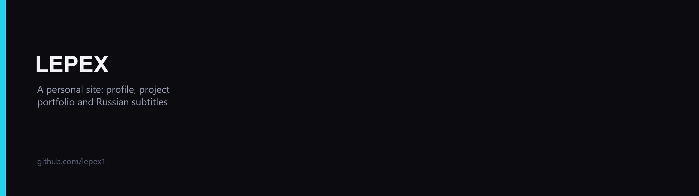
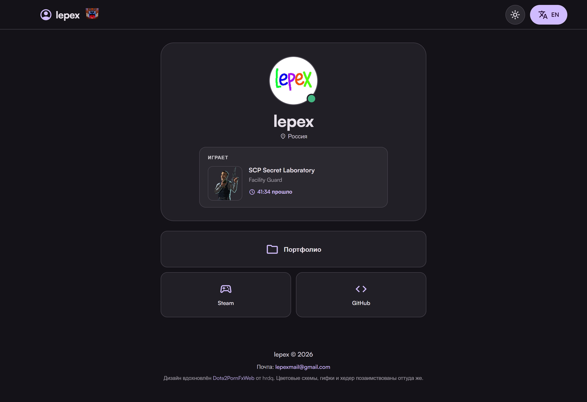
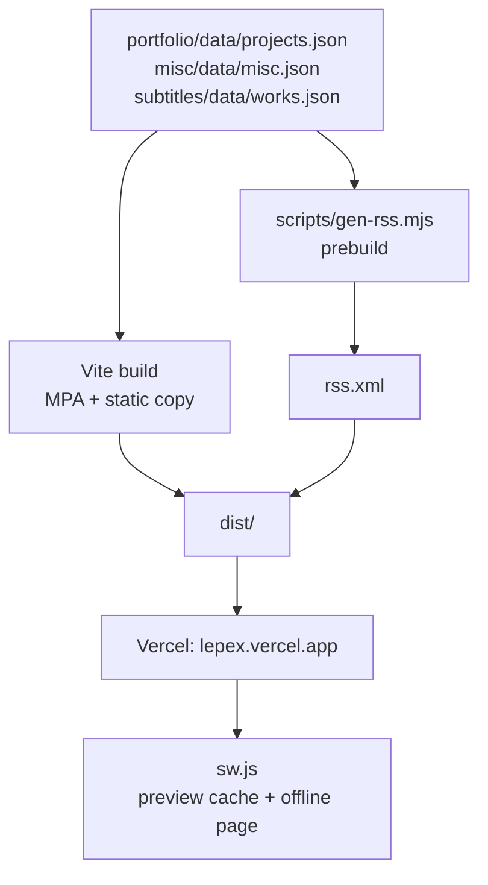

<p align="center">
  <a href="README.md">Русский</a> · <b>English</b>
</p>

# lepex

<p align="center">
  
</p>

<p align="center">
  <a href="https://lepex.vercel.app/"></a>
  
  
  <a href="LICENSE"></a>
</p>

<p align="center">
  <b>Puts a Discord profile, a portfolio of small tools and Russian subtitles<br>
  on one static site: plain HTML/CSS/JS, no framework and no client runtime.</b>
</p>
<p align="center">
  <a href="https://lepex.vercel.app/">Open the site</a>
</p>

---

## Demo

The site is the demo: **[lepex.vercel.app](https://lepex.vercel.app/)**. Nothing to install, it opens in a browser.

What to look at:

- **Portfolio** — CASSIE Command Browser, Img2TgGif (images to GIF in the browser), an animated gradient text generator, a VPN config validator, and the subtitles page;
- **Profile** — Discord status through Lanyard, light and dark themes, RU/EN switch;
- **Misc** — things I liked: Emesis Blue subtitles in 19 languages, a medical library.

## Screenshot

<p align="center">
  
</p>

## Why it exists

My work lived in scattered places: one page on GitHub Pages, other things as repositories, subtitles as loose files in cloud storage. Anyone arriving from a link had to put the picture together themselves.

What the site does:

1. **Collects** everything personal in one place: profile, links, Discord status.
2. **Gives** every project its own page with a description, screenshots and source.
3. **Serves** what cannot live in a repository as code: subtitles per language, a PDF library.
4. **Keeps working** offline after the first visit (service worker) and installs on a phone as a PWA.
5. **Builds its RSS** from the same JSON the project cards use.

## Compatibility

| Parameter | Value |
|---|---|
| Browsers | current Chrome, Edge, Firefox, Safari |
| Viewports | 375 px to 1920 px; grids reflow 1 / 2 / 3 columns |
| Frameworks | none: hand-written HTML, CSS and ES modules |
| External dependencies | only the Material Symbols icon font (Google Fonts); Satoshi ships locally |
| Build | Vite 6, Node 20+ (Node 22 on Vercel) |
| Hosting | Vercel, serving static files from `dist/` |

## Quick start

1. Open **[lepex.vercel.app](https://lepex.vercel.app/)** — that is all.
2. `serve-local.bat` serves the already built `dist/` on `http://127.0.0.1:4173/` and opens a browser.
3. Build output lives in `dist/` — exactly what ships to Vercel.

## Run from source

```bash
git clone https://github.com/lepex1/lepex.git
cd lepex
npm install
npm run dev       # vite dev on http://localhost:5173
npm run build     # dist/ + rss.xml
npm run preview   # preview the build
```

`npm run build` runs `prebuild` (`scripts/gen-rss.mjs`), which regenerates `rss.xml` from `portfolio/data/projects.json` and `portfolio/subtitles/data/works.json`, `lastBuildDate` included. To keep the date out of the commit: `git restore -- rss.xml` after the build.

Deploying is a plain `git push` to `main`: Vercel runs `npm run build` and serves `dist/`.

## How it works



- **Cards are not in the HTML.** The portfolio, misc and subtitles lists render from JSON, so a new entry is a data edit, not markup.
- **Bilingual without libraries.** Every text exists twice in the markup (`data-lang-ru` / `data-lang-en`, `.lang-ru` / `.lang-en`); switching is one class on `<html>`.
- **Theme and language are attributes on `<html>`.** The choice applies before first paint (`js/preload.js`): no light-theme flash, no re-render.
- **Eight preview GIF sets** switch by class instead of separate pages.
- **Service worker: network first, cache second.** HTML stays fresh, preview images are cached, `offline.html` covers a dropped connection.

## ⚠️ Read this

- **Service worker caching.** After a deploy you may still see the previous version — hard reload with `Ctrl+Shift+R` (`Cmd+Shift+R`).
- **Icons are an external font.** Material Symbols comes from Google Fonts; on a very slow connection you can see icon names as text for a moment. A loading screen that hides this is not built yet.
- **Discord status is a third party.** The public [Lanyard](https://api.lanyard.rest/) API; if it is down the status block stays empty and the rest of the site works.
- **Not my content.** Subtitles, the PDF library and previews belong to their authors and translators; they are here as a personal collection, not as a publication. Details in [THIRD-PARTY-NOTICES.md](THIRD-PARTY-NOTICES.md).
- **A personal site, not a template.** Texts, links and avatars are mine; reusing it elsewhere means editing the markup and the JSON.

## FAQ

**I see words instead of icons — `medical_services`, `arrow_back`.** The icon font from Google Fonts did not load. Reload the page; on a slow connection it repeats until the font arrives.

**The site shows an old version.** That is the service worker serving cache. A hard reload fixes it.

**How do I add a project to the portfolio?** Add an entry to `portfolio/data/projects.json` (`id`, `date`, `title`/`titleRu`, `desc`/`descRu`, `link`, `tags`) and a page folder under `portfolio/<id>/`. The RSS regenerates on `npm run build`.

**Why no React / Next / Astro?** Nothing here needs a runtime: pages are static and data changes rarely. Vite is only there to build and copy assets.

**Where do the subtitles come from?** `portfolio/subtitles/data/works.json` lists the works and `portfolio/misc/emesis-blue/subs/` holds the `.srt` files per language.

## License

Code is [MIT](LICENSE). Third-party components, fonts, images and other people's content are listed in [THIRD-PARTY-NOTICES.md](THIRD-PARTY-NOTICES.md). The project is not affiliated with SCP: Secret Laboratory, FoxGame, New Blood Interactive or the authors of the materials in Misc.

---

<p align="center">
  Built by <a href="https://github.com/lepex1">lepex1</a>
</p>
