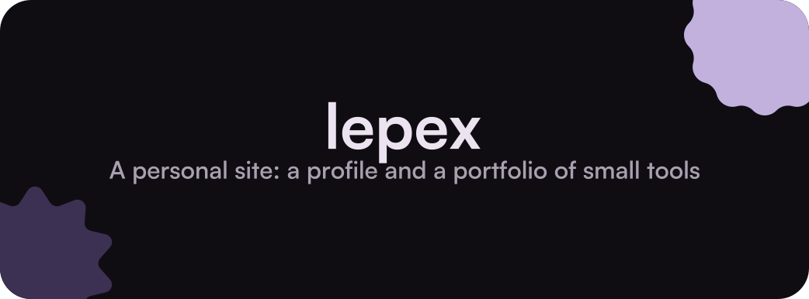
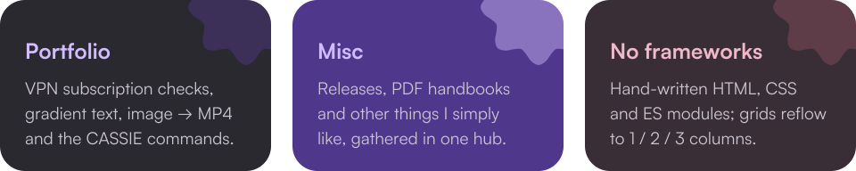
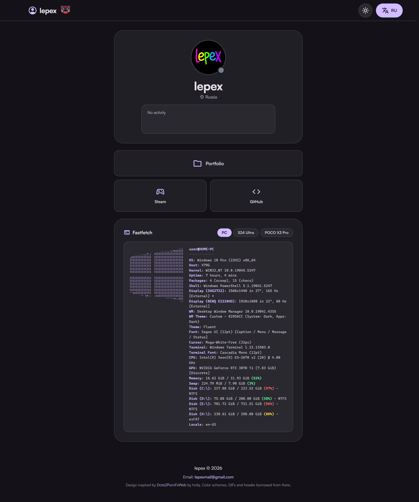

<div align="center">

  <p><a href="README.md">Русский</a> · <b>English</b></p>

  

  <h3>A personal site: a profile and a portfolio of small tools</h3>

  <p>
    <a href="https://lepex.vercel.app/"></a>
    <a href="https://github.com/lepex1"></a>
  </p>

  <p>
    <a href="https://github.com/lepex1/lepex/commits/main"></a>
    <a href="LICENSE"></a>
  </p>

</div>

<h3></h3>

My personal page where you can see my projects and things I simply like. It shows my current Discord activity through Lanyard.

| Parameter | Value |
|---|---|
| Browsers | current Chrome, Edge, Firefox, Safari |
| Viewports | 375 px to 1920 px; grids reflow to 1 / 2 / 3 columns |
| Frameworks | none: hand-written HTML, CSS and ES modules |
| External dependencies | only the Material Symbols icon font (Google Fonts); Satoshi ships locally |
| Build | Vite 6, Node 22 |
| Hosting | Vercel, serving static files from `dist/` |

<h3></h3>

<p align="center">
  
</p>

- [**Portfolio**](https://lepex.vercel.app/portfolio/) — public VPN subscription checks, a gradient text generator, image → MP4 for Telegram and the CASSIE command set.
- [**Misc**](https://lepex.vercel.app/portfolio/misc/) — releases, PDF handbooks and other things I simply like.
- **No frameworks** — vanilla HTML, CSS and ES modules; the build only bundles and minifies.

<h3></h3>

<p align="center">
  
  <br>
  
</p>

<h3></h3>

```bash
git clone https://github.com/lepex1/lepex.git
cd lepex
npm install
npm run dev
```

Build with `npm run build`; the output lands in `dist/`.

<h3></h3>

Code is [MIT](LICENSE). Third-party material, owned by its authors, is listed in [THIRD-PARTY-NOTICES.md](THIRD-PARTY-NOTICES.md).

---

<p align="center">
  Made by <a href="https://github.com/lepex1">lepex1</a>
</p>
