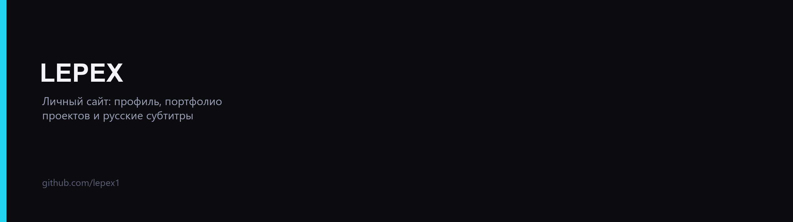
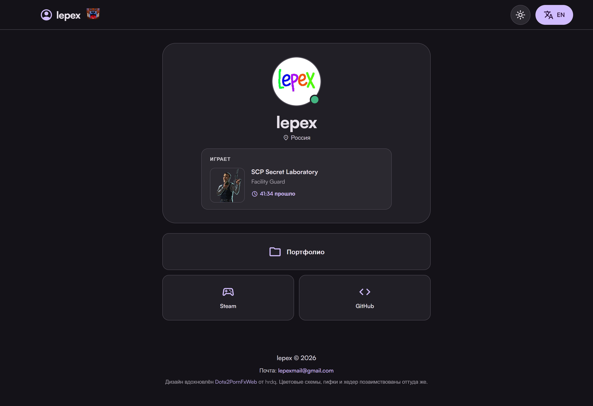
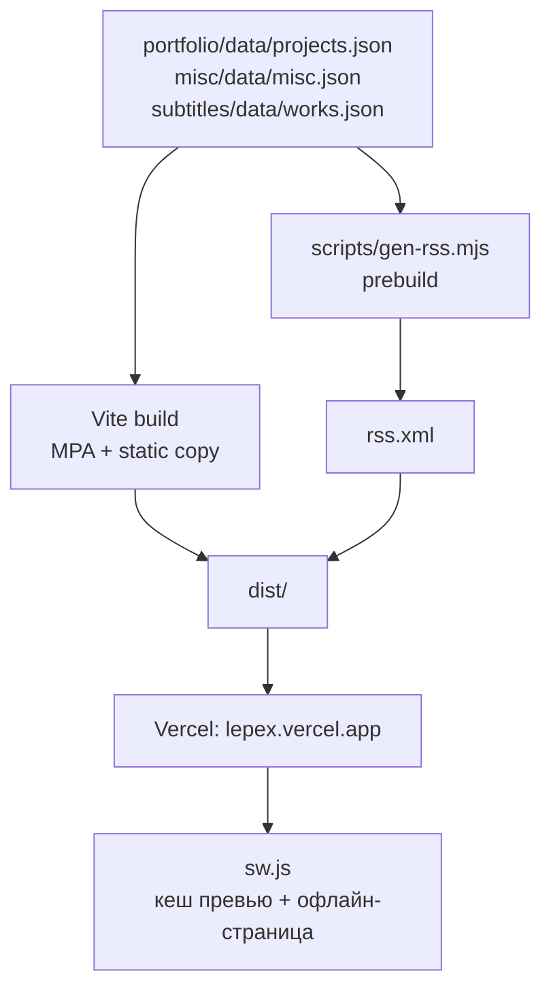

<p align="center">
  <b>Русский</b> · <a href="README.en.md">English</a>
</p>

# lepex

<p align="center">
  
</p>

<p align="center">
  <a href="https://lepex.vercel.app/"></a>
  
  
  <a href="LICENSE"></a>
</p>

<p align="center">
  <b>Собирает профиль, портфолио мини-инструментов и русские субтитры<br>
  в один статический сайт: чистый HTML/CSS/JS, без фреймворков и клиентского рантайма.</b>
</p>
<p align="center">
  <a href="https://lepex.vercel.app/">Открыть сайт</a>
</p>

---

## Демонстрация

Сайт — это и есть демонстрация: **[lepex.vercel.app](https://lepex.vercel.app/)**. Установки нет, открывается в браузере.

Что посмотреть по пунктам меню:

- **Портфолио** — CASSIE Command Browser, Img2TgGif (конвертация картинок в GIF прямо в браузере), генератор градиентного текста, проверялка VPN-конфигов и субтитры;
- **Профиль** — статус Discord через Lanyard, светлая и тёмная темы, переключатель RU/EN;
- **Misc** — материалы, которые мне зашли: субтитры к Emesis Blue на 19 языках, медицинская библиотека.

## Скриншот

<p align="center">
  
</p>

## Зачем это нужно

Мои проекты жили в разных местах: один — страница на GitHub Pages, другие — репозитории, субтитры — вообще файлами в облаке. Человеку, который пришёл по ссылке, приходилось собирать картинку самому.

Что делает сайт:

1. **Собирает** всё личное в одном месте: профиль, ссылки, статус в Discord.
2. **Показывает** каждый проект отдельной страницей с описанием, скриншотами и исходниками.
3. **Отдаёт** то, что нельзя положить в репозиторий как код: субтитры по языкам, PDF-библиотеку.
4. **Работает** после первого захода офлайн (service worker) и ставится на телефон как PWA.
5. **Считает** RSS сам — из тех же JSON, что и карточки проектов.

## Совместимость

| Параметр | Значение |
|---|---|
| Браузеры | актуальные Chrome, Edge, Firefox, Safari |
| Разрешения | от 375 px до 1920 px; сетки перестраиваются 1 / 2 / 3 колонки |
| Фреймворки | нет: рукописный HTML, CSS и ES-модули |
| Внешние зависимости | только шрифт иконок Material Symbols (Google Fonts); Satoshi лежит локально |
| Сборка | Vite 6, Node 20+ (на Vercel — Node 22) |
| Хостинг | Vercel, раздача статики из `dist/` |

## Быстрый старт

1. Открыть **[lepex.vercel.app](https://lepex.vercel.app/)** — больше ничего не нужно.
2. Есть `serve-local.bat` — поднимает локально уже собранный `dist/` на `http://127.0.0.1:4173/` и открывает браузер.
3. Результат сборки лежит в `dist/` — это ровно то, что уезжает на Vercel.

## Запуск из исходного кода

```bash
git clone https://github.com/lepex1/lepex.git
cd lepex
npm install
npm run dev       # vite dev на http://localhost:5173
npm run build     # dist/ + rss.xml
npm run preview   # предпросмотр собранного
```

`npm run build` запускает `prebuild` (`scripts/gen-rss.mjs`), который перегенерирует `rss.xml` из `portfolio/data/projects.json` и `portfolio/subtitles/data/works.json` — в том числе `lastBuildDate`. Если дату в коммит тащить не нужно, после сборки: `git restore -- rss.xml`.

Деплой — обычный `git push` в `main`: Vercel собирает `npm run build` и раздаёт `dist/`.

## Как работает



- **Карточки не в HTML.** Портфолио, misc и субтитры рендерятся из JSON — новая запись это правка данных, а не разметки.
- **Двуязычность без библиотек.** Текст в двух вариантах в разметке (`data-lang-ru` / `data-lang-en`, `.lang-ru` / `.lang-en`), переключение — один класс на `<html>`.
- **Тема и язык — атрибуты на `<html>`.** Выбор применяется до первой отрисовки (`js/preload.js`): без вспышки светлой темы и без перерисовки разметки.
- **Восемь наборов гифок-превью** переключаются классом, а не отдельными страницами.
- **Service worker: сеть первая, кеш второй.** HTML всегда свежий, картинки-превью кешируются, при обрыве — `offline.html`.

## ⚠️ Важно понимать

- **Кеш service worker'а.** После обновления сайта можно увидеть прошлую версию — жёсткое обновление `Ctrl+Shift+R` (или `Cmd+Shift+R`).
- **Иконки — внешний шрифт.** Material Symbols приходит с Google Fonts; при очень медленной сети на секунду видно текстовые имена иконок вместо картинок. Экран загрузки, который это прикрывает, пока не сделан.
- **Статус Discord — чужой сервис.** Публичный [Lanyard](https://api.lanyard.rest/); если он лежит, блок статуса просто не отрисуется, остальной сайт работает.
- **Чужой контент.** Субтитры, PDF-библиотека и превью — не мои материалы, права у авторов и переводчиков; они лежат здесь как личная подборка, а не как публикация. Подробности — в [THIRD-PARTY-NOTICES.md](THIRD-PARTY-NOTICES.md).
- **Сайт личный, не шаблон.** Тексты, ссылки и аватарки — мои; форк под себя потребует правок в разметке и JSON.

## Частые вопросы

**Вместо иконок вижу слова — `medical_services`, `arrow_back`.** Не загрузился шрифт иконок с Google Fonts. Обновите страницу; на медленном соединении повторится, пока не прогрузится шрифт.

**Открывается старая версия сайта.** Так работает service worker: он отдаёт кеш. Жёсткое обновление снимает вопрос.

**Как добавить проект в портфолио?** Запись в `portfolio/data/projects.json` (`id`, `date`, `title`/`titleRu`, `desc`/`descRu`, `link`, `tags`) плюс папка со страницей в `portfolio/<id>/`. RSS пересоберётся сам на `npm run build`.

**Почему нет React/Next/Astro?** Здесь нет ничего, что требует рантайма: страницы статические, данные меняются редко. Vite нужен только для сборки и копирования ассетов.

**Где исходники субтитров?** `portfolio/subtitles/data/works.json` (список работ) и `portfolio/misc/emesis-blue/subs/` (файлы `.srt` по языкам).

## Лицензия

Код — [MIT](LICENSE). Сторонние компоненты, шрифты, картинки и чужой контент перечислены в [THIRD-PARTY-NOTICES.md](THIRD-PARTY-NOTICES.md). Проект не аффилирован с SCP: Secret Laboratory, FoxGame, New Blood Interactive и авторами материалов из раздела Misc.

---

<p align="center">
  Сделал <a href="https://github.com/lepex1">lepex1</a>
</p>
