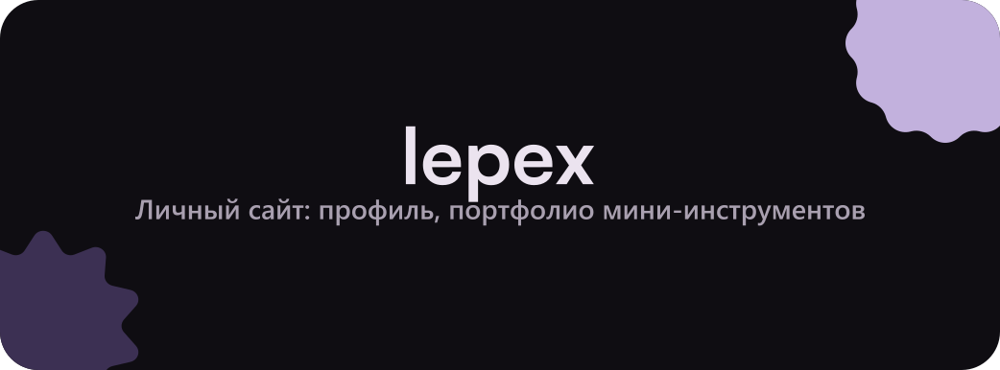
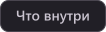
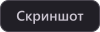
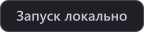
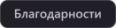
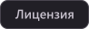
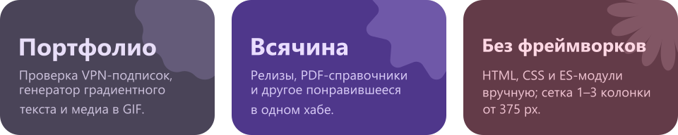
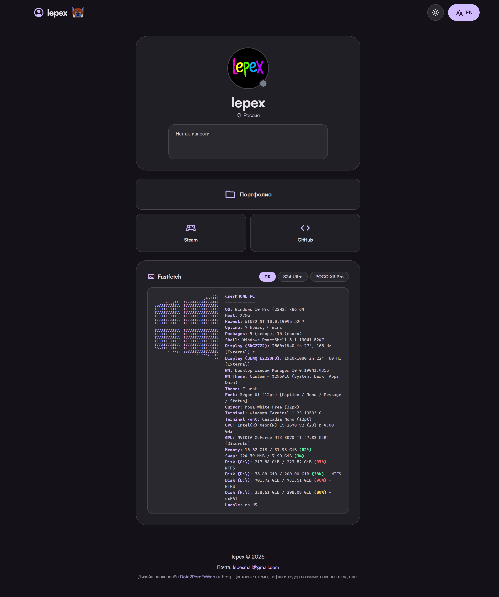
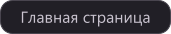

<div align="center">
  <p><b>Русский</b> · <a href="README.en.md">English</a></p>

  

  <h3>Личный сайт: профиль, портфолио мини-инструментов</h3>

  <p>
    <a href="https://lepex.vercel.app/"></a>
  </p>

  <p>
    <a href="https://github.com/lepex1/lepex/commits/main">
      
    </a>
    <a href="LICENSE">
      
    </a>
    
    
  </p>

  <p>
    <a href="#inside"></a>
    <a href="#screenshot"></a>
    <a href="#run"></a>
    <a href="#thanks"></a>
    <a href="#license"></a>
  </p>
</div>

<h3><a name="about"></a></h3>

Моя личная страничка, на которой можно ознакомиться с моими проектами и вещами, которые мне просто нравятся. Показывает мою текущую Discord активность через Lanyard.

| Параметр | Значение |
|---|---|
| Браузеры | актуальные Chrome, Edge, Firefox, Safari |
| Разрешения | от 375 px до 1920 px; сетки перестраиваются 1 / 2 / 3 колонки |
| Фреймворки | нет: рукописный HTML, CSS и ES-модули |
| Внешние зависимости | только шрифт иконок Material Symbols (Google Fonts); Satoshi лежит локально |
| Сборка | Vite 6, Node 22 |
| Хостинг | Vercel, раздача статики из `dist/` |

<h3><a name="inside"></a></h3>

<p align="center">
  
</p>

- [**Портфолио**](https://lepex.vercel.app/portfolio/) — проверка публичных VPN-подписок, генератор градиентного текста, конвертер картинок и видео в GIF для Telegram и база команд CASSIE.
- [**Всячина**](https://lepex.vercel.app/portfolio/misc/) — релизы, PDF-справочники и другие понравившиеся штуки.
- **Без фреймворков** — ванильные HTML, CSS и ES-модули; сборка только для склейки и минификации.

<h3><a name="screenshot"></a></h3>

<p align="center">
  
  <br>
  
</p>

<h3><a name="run"></a></h3>

```bash
git clone https://github.com/lepex1/lepex.git
cd lepex
npm install
npm run dev
```

Сборка — `npm run build`, результат в `dist/`.

<h3><a name="thanks"></a></h3>

- **[h6rd](https://github.com/h6rd/Dota2PornFxWeb)** — дизайн сайта и структура этого README
- **Indian Type Foundry** — шрифт [Satoshi](https://www.fontshare.com/fonts/satoshi)
- **Google** — шрифт иконок [Material Symbols](https://fonts.google.com/icons)
- **FFmpeg** и [ffmpeg.wasm](https://github.com/ffmpegwasm/ffmpeg.wasm) — перекодирование картинок и видео в MP4/GIF прямо в браузере

<details>
<summary><b>Чужие материалы</b></summary>

<br>

Шрифты, PDF-справочники, субтитры и гифки принадлежат их авторам и лицензией проекта не покрыты. Полный список — [THIRD-PARTY-NOTICES.md](THIRD-PARTY-NOTICES.md).

</details>

<h3><a name="license"></a></h3>

- **Код** — [MIT](LICENSE)
- **Не мои материалы** — чьи права у авторов; список в [THIRD-PARTY-NOTICES.md](THIRD-PARTY-NOTICES.md)

---

<p align="center">
  Сделал <a href="https://github.com/lepex1">lepex1</a>
</p>
